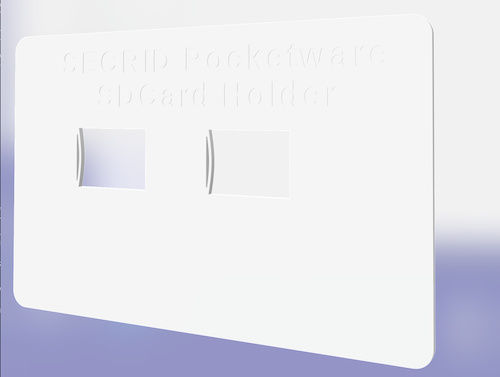

# 3d-printing
Collection of 3D-models, fixes, ideas, problem solvers

> Disclaimer: these designs are for my personal use. They are "as-is". No guarantee. Improvements are appreciated.

# SECRID Card Protector
For years I'm enjoying the SECRID card protector/wallet. A bunch of creditcard and loyalty cards packed and protected from bending and spoofing.

When on holidays you carry all kind of travel papers. These could be made digital by scanning them and add some more info that is important onto a SDCARD. But where to put your SDCARD? Well, put it into the SECRID Wallet!

Goto [SECRID Pocketware](SECRID)

# Takachi Enclosures
Sometimes you want to mount a development board inside an enclosure. There are two (three) solutions:

- Create a custom enclosure that fits the board
- Use a standard enclosure and mill the right holes to mount the board
- Create a base plate that fits the board(s) and has the right size to fit an enclosure, including the mounting positions

The last solution uses [OpenSCAD](Takachi/Enclosure%20Mounting%20Plates.md). 

# IKEA DISHWASHER

My son's kitchen has a Ikea Dishwasher. The front plate broke of as the nylon clip broke off. See [tillreda](IKEA/tillreda%20vaatwasser/README.md).

You will find the STL models and FreeCad source macro.
